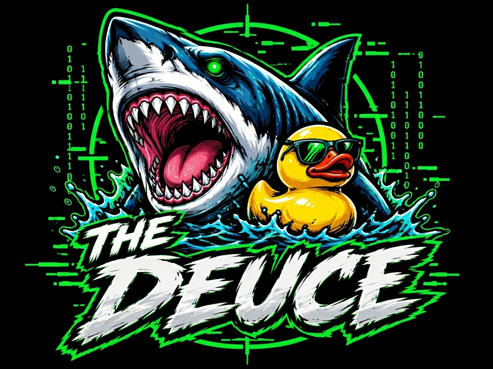

 <p align="center">
  
</p>

<p align="center">
  <em>One rig. Two brains. Multiple attack surfaces. Total situational awareness.</em>
</p>

<p align="center">
  
  &nbsp;·&nbsp; ESP32-WROOM-32U &nbsp;·&nbsp; ILI9341 Touch &nbsp;·&nbsp; Private Build
</p>

---

## `// SYST3M OVERV1EW`

The Deuce is a custom built ESP32 handheld, engineered for wireless diagnostics, signal exploration, hardware interaction, and on-device intelligence.

Fabricated around the ESP32-WROOM-32U and a 2.4-inch touchscreen, it integrates a collection of radio interfaces, peripheral controllers, and purpose built firmware into a compact field platform.

No bullshit. No unnecessary overhead. Just a custom environment, made for direct access to the tools that matter most.

**Core capabilities**

- Wireless network reconnaissance and diagnostics
- SubGHz RF and 2.4 GHz radio experimentation
- Infrared transmission and reception
- NFC / RFID interaction
- GPS positioning and RTC integration
- SD based storage and utilities
- Local device WebUI
- On-device interface for Anthropic's Claude AI

> **Build status:** Personal, private, continuously evolving firmware. Not a commercial product and not intended for distribution.

---

## `// OPERAT0R INT3RFACE`

### Custom segmented-LCD UI

The interface is built from the ground up around a Matrix/hacker style, segmented LCD aesthetic.

- **Three-page touch interface** — a 2×2 swipe based menu grid, with direct tile access and no navigation bars.
- **14-segment starburst typography** — custom rendered glyphs with deliberate segment breaks, consistent character height, and precise spacing.
- **Matrix rain engine** — animated background rendered behind the interface, with reserved label regions to prevent visual interference.
- **Live system header** — clock, battery percentage, WiFi, SD, BLE, GPS, and WebUI status indicators.
- **Hardware flash indicator** — lightning bolt status indicator triggered by the GPIO2 flash switch.
- **Dedicated Back input** — GPIO36 hardware button with debounce handling. No getting stuck.

The goal: a high-information interface that stays readable, responsive, and consistent across the device.

---

## `// INT3LLIGENCE 5UBSYST3M`

### Claude AI · On-device interface

A direct interface to Anthropic's Messages API, accessible from the handheld over WiFi.

- Selectable Haiku, Sonnet, Opus, or custom model ID.
- Adjustable output-token limit.
- Stateless request/response execution to avoid accumulating conversation history on memory-constrained hardware.
- API key configuration directly on the device or through the WebUI at `/claude`.
- Credentials remain on the device and are not committed to the repository.

The ESP32 handles the interface and network transport; inference is performed by Anthropic's remote API.

---

## `// NETW0RK H3ALTH & EXP0SURE`

### Health Checks

Eight defensive network testing modules are available under `Others → Health Checks`.

| Module | Purpose |
|---|---|
| WiFi Hygiene | Inspect basic wireless security configuration |
| Internet / Latency | Check connectivity and response times |
| Device Inventory | Identify devices visible on the local network |
| Service / Port Scan | Discover exposed services on authorized targets |
| Attack Watchdog | Monitor for supported suspicious activity |
| Rogue DHCP | Check for unexpected DHCP activity |
| UPnP / mDNS Exposure | Inspect local service-discovery exposure |
| Health Report | Consolidate available diagnostic results |

Designed for authorized environments, homelab testing, and understanding the devices/services exposed on your own network.

---

## `// WEB C0NTROL PL4NE`

### De-branded WebUI

The device hosts its own local web interface at:

- `http://deuce.local`
- `http://<device-ip>`

Features include:

- Dedicated login
- Matrix-green visual theme
- Animated rain effect
- Theme colors synchronized with the device UI
- Device branding and Claude AI configuration

The WebUI provides a second control surface, without requiring interaction through the touchscreen for every configuration task.

---

## `// RAD1O & PERIPH3RAL STACK`

| Subsystem | Hardware / Function |
|---|---|
| MCU | ESP32-WROOM-32U |
| Sub-GHz | CC1101 |
| 2.4 GHz RF | NRF24 |
| Wireless networking | WiFi |
| Bluetooth | BLE |
| Infrared | Dedicated TX / RX |
| Positioning | NEO-6M GPS |
| NFC / RFID | PN532 |
| Timekeeping | DS3231 RTC |
| Storage | SD card |
| Display | 2.4-inch ILI9341, 320×240 |
| Touch | XPT2046 resistive touchscreen |
| Power monitoring | Battery ADC |
| Hardware input | GPIO36 Back button |

A shared SPI architecture keeps the radio and storage peripherals on a tightly packed bus layout, while the display and touch controller use their own assigned interface.

---

## `// H4RDWAR3 MAP`

### Controller

- **MCU:** ESP32-WROOM-32U
- **Memory:** Classic ESP32, no PSRAM
- **Flash:** 4 MB
- **Display:** ILI9341, 320×240, rotation 3
- **Touch controller:** XPT2046

### Pin assignments

| Interface | Signal | GPIO |
|---|---|---:|
| Touch / VSPI | SCLK | 18 |
| Touch / VSPI | MOSI | 23 |
| Touch / VSPI | MISO | 19 |
| Touch / VSPI | CS | 21 |
| Radio / SD SPI | SCK | 14 |
| Radio / SD SPI | MOSI | 13 |
| Radio / SD SPI | MISO | 26 |
| CC1101 | SS | 22 |
| NRF24 | CSN | 27 |
| SD | CS | 15 |
| I²C | SDA | 0 |
| I²C | SCL | 2 |
| Infrared | TX | 25 |
| Infrared | RX | 35 |
| GPS | NEO-6M | — |
| Battery monitor | ADC | 39 |
| Back button | Input | 36 |

### Flash layout

| Partition | Allocation |
|---|---:|
| Application | 3.69 MB |
| LittleFS | 256 KB |
| Total flash | 4 MB |

Partition configuration: `custom_4Mb_deuce.csv`

---

## `// D3VELOPMENT R0ADMAP`

Current development targets:

- [x] Stopwatch and countdown timer — `99:99:99`
- [ ] Barcode generation — Code 128, UPC-A, EAN-13, Code 93, Code 39, Code 11
- [ ] On-screen barcode output and PNG export to SD
- [ ] IR appliance library with SD-backed code database and browser
- [x] Intervalometer
- [x] VIN decoder — offline WMI lookup and online NHTSA lookup
- [ ] Lock combination calculator
- [ ] Sentry-Safe I²C interface
- [x] QR Saved Codes tab

Features are developed incrementally and remain subject to hardware, memory, and firmware constraints.

---

## `// BU1LD & DEPL0YMENT`

### Requirements

- [PlatformIO](https://platformio.org/)
- Compatible ESP32 development environment
- USB connection to the target device

### Compile

```bash
pio run -e Deuce_v1_1
```

### Flash

```bash
pio run -e Deuce_v1_1 -t upload
```

Build artifacts:

```text
.pio/build/Deuce_v1_1/
```

Every push is compiled through the `Deuce CI` GitHub Actions workflow. CI reports flash and RAM usage so partition constraints can be monitored BEFORE firmware is deployed.

The legacy `Deuce` environment remains available for reference to the original stock style menu.

---

## `// S3CURITY & PR0JECT ST4TUS`

The Deuce is a personal hardware and firmware project.

- Not a commercial product.
- Not intended for public distribution.
- Network testing is intended for authorized systems and environments.
- API credentials are configured on-device, and must never be committed to source control.

Use the device responsibly, and only against systems you *own* or have explicit permission to test.

---

<p align="center">
  <code>NO BULLSHIT // NO UNNECESSARY OVERHEAD // BUILD YOUR OWN TOOLCHAIN</code>
</p>

<p align="center">
  <sub>Built on the open-source <a href="https://github.com/pr3y/Bruce">Bruce</a> firmware. Independently customized for The Deuce.</sub>
</p>